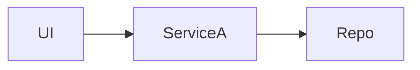
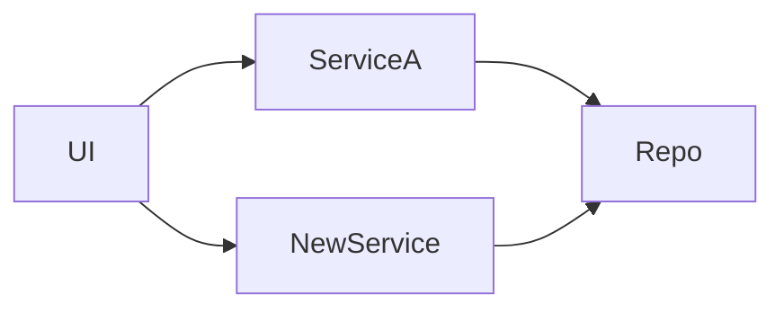

For non-trivial implementation tasks, plan before you code. Treat every change as a system change, not an isolated patch. Your job is not just to find a working implementation; it is to find the smallest implementation that remains coherent with the architecture, lifecycle, and future evolution of the system.

## Call Graphs (Required)

Every plan documents **how interfaces compose and where boundaries sit** — not just which files change. Trace the real call stack from entry point to leaf during exploration, then show **before** and **after** in the plan. Agents and humans use these stacks to implement interfaces without guessing composition roots or layer boundaries.

**No exceptions:**
- Every plan includes a `## Call Graph` section with **Before** and **After** blocks
- Build the **before** graph during Step 1 (Explore); build the **after** graph during Step 3 (Design)
- Use indented `→` chains — **not mermaid** — for call stacks
- When production and tests swap layers (memory vs SQL, mock vs live), show **both** stacks in each block
- Replace placeholders with real module/layer names from exploration
- Annotate every change inline: `← new`, `← moved`, `← now owns X`

### Format

ALWAYS use this structure inside each Before/After block:

```ts
Production:
<entry point>
  → <layer or composition root>
    → <next hop>
      → <leaf implementation>

Tests:
<entry point>
  → <test layer / memory layer>
    → <same inner stack or divergent path>
      → <memory or mock impl>
```

Omit long unchanged subtrees with `→ … (unchanged)`. Mark moved responsibility on the line that **gains** it, not the line that loses it.

### Before / After Example

**Before** — current stacks (no annotations):

```ts
Production:
HTTP handlers
  → LinkCatalog
    → LinkCatalog.layerDurableObject
      → Effect RPC over Durable Object fetch
        → LinkCatalog.layer
          → LinkCatalogCoordinator
            → LinkCatalogStore
              → LinkCatalogSqlExecutor
          → PublicRedirectIndexService

Tests:
HTTP handlers
  → LinkCatalog
    → linkCatalogMemoryLayer
      → LinkCatalog.layer
        → LinkCatalogCoordinator
          → LinkCatalogStore.layerMemory
          → PublicRedirectIndexService.layerMemory
```

**After** — same stacks with inline change markers:

```ts
Production:
HTTP handlers
  → LinkCatalog
    → LinkCatalog.layerDurableObject
      → Effect RPC over Durable Object fetch
        → LinkCatalog.layer
          → LinkResolver                        ← new: resolves slug before catalog read
          → LinkCatalogCoordinator
            → LinkCatalogStore
              → LinkCatalogSqlExecutor
            → PublicRedirectIndexService        ← moved: coordinator now owns redirect lookup

Tests:
HTTP handlers
  → LinkCatalog
    → linkCatalogMemoryLayer
      → LinkCatalog.layer
        → LinkResolver.layerMemory              ← new: same boundary, memory impl
        → LinkCatalogCoordinator
          → LinkCatalogStore.layerMemory
          → PublicRedirectIndexService.layerMemory
```

> **Note:** Call graphs show **who calls whom** through layers and composition roots. They complement mermaid architecture graphs (component boxes) and pseudocode (control flow inside a function). A file list alone is not a call graph.

### Rationalizations — Do Not Skip

| Excuse | Reality |
|--------|---------|
| "The file list is enough" | Files don't show composition roots, layer boundaries, or test/production divergence. |
| "Mermaid diagram covers it" | Mermaid shows component boxes; call graphs show the stack you implement. |
| "Small change, no graph needed" | Small changes still shift boundaries. Trace and show both stacks. |
| "I'll add the graph at the end" | Before graph belongs in Step 1; after graph in Step 3. Both go in the plan before presentation. |
| "Production and tests are the same" | Say so explicitly in the Tests block — do not omit it. |

### Red Flags — STOP

- Plan has no `## Call Graph` section
- Only file paths listed — no indented `→` chains
- After graph identical to before with no inline change markers
- Production stack shown but Tests stack omitted when layers diverge
- New service added in Approach but absent from the after graph

## Planning Doctrine

- **Think broadly, implement narrowly.** Analyze the surrounding system before deciding where the change belongs.
- **Every change has system implications.** Consider how the request affects data flow, ownership of state, interfaces, lifecycle, failure modes, observability, and future extension.
- **Prefer authoritative, derivable designs.** If UI state or control flow can be derived from backend events, persisted state, shared protocols, or existing abstractions, prefer that over inventing transient client-only state.
- **Choose the smallest coherent solution.** Do not default to the smallest local patch if it distorts the architecture or adds hidden follow-on complexity.
- **Expand scope only when it simplifies the system.** Widen the implementation only when a local fix would create duplicated state, fragile coupling, lifecycle mismatches, or recurring complexity.
- **Do not gold-plate.** Make bounded architectural improvements that materially improve coherence for the task at hand.

## Testing Doctrine

Every test a plan specifies is an **integration test** (public entry → real collaborators → observable outcome, external I/O stubbed at the transport boundary) or an **E2E test** (Playwright against the running stack). Plans do not specify unit tests. When exploration finds an existing test that acts below the public entry on behavior this plan changes, the plan rewrites it as an integration test and lists the file under **Files Modified**.

> **Goal of a test:** encode **usage intent**. When it goes red, a usage pattern someone considers critical broke.

### The integration contract

Every test in the plan answers yes to all three:

1. **Same door as production?** Act through the public entry — HTTP route handler, worker `perform`, exported service function, CLI command — the one production itself calls.
2. **Same path to the signal?** Build state the way production builds it: factories, production seed helpers, real collaborators up to the external boundary.
3. **Outcome, not implementation?** Assert the system reaction — persisted row, emitted event, returned payload, changed flag. **Half a test is not a test:** reaching a collaborator is the first half; assert what changed because it was reached.

In the **After** call graph, the Tests stack enters at the same door as Production and diverges only at the external boundary.

### Buckets

| Bucket | Proves | Plan stance |
|---|---|---|
| **1 — Positive integration** | Public entry → real path → persisted or observable outcome | Required for every behavior change |
| **2 — Wiring** | Collaborator called with the right arguments | Supplement only, never the sole coverage |
| **3 — Degradation** | Rescue, timeout, or fail-open branch, with the outcome asserted per contract | Required when the failure branch is non-obvious |

### Mock boundary

Stub at the **deepest layer that still avoids real network** — `fetch`, the HTTP transport, or an MSW handler — rather than the first named client method. If removing the stub would skip code this plan adds (payload build, serialization, routing), the stub is too shallow.

### Fake integration

These pass without proving behavior. Hunt for them in Step 4 and in every plan you review:

| Pattern | Why it lies |
|---|---|
| Calling a private or intermediate function directly | Skips entry guards and error handling; stays green when the policy gating it breaks |
| Seeding internal storage keys by hand | Proves the store accepts writes, not that the production path wrote them |
| Asserting on fixtures created in setup | Tests the factory, not the feature |
| Spy as the sole proof, with no state change | Green when the call is skipped by an early return or a swallowed error |
| Stubbing the façade whose payload build is under test | Only proves the arguments reached the mock |
| "e2e" as a label on a heavily stubbed direct call | Misleads review — name it `integration via <entry point>` |

### Soundness check

Every Bucket-1 example carries one: **break** the production line the example claims to cover, **re-run**, watch it go **red**, **restore**. Multi-leg behavior (external send plus async outcome) gets one check per leg — breaking the send reds the wire assertion, breaking the outcome path reds the persistence assertion. A plan that specifies tests without soundness checks is unfinished.

## Configuration

| Variable | Default | Purpose |
|----------|---------|--------|
| `PLAN_DIR` | `bk-docs/superpowers/plans` | Base directory for plan files (relative to project root) |

Set `PLAN_DIR` as an environment variable to override the default:

```bash
export PLAN_DIR=bk-docs/superpowers/plans  # default
export PLAN_DIR=.planning                  # alternative
```

## Plan File

Write your plan to `${PLAN_DIR}/<YYYY-MM-DD>-<project-name>/PLAN.md`. Each planning session gets its own subdirectory under `${PLAN_DIR}/`.

**Project naming convention:** descriptive, lowercase, hyphen-separated — like a commit message slug.

- The name should describe **what the plan does**, not be a random identifier.
- Keep it short (2–5 words), all lowercase, hyphens between words.
- For sub-plans spawned by agents, append `-agent-<short-hash>` to the directory name.

Examples:
```
plans/fix-mock-swap-provider/PLAN.md
plans/add-exact-debt-read/PLAN.md
plans/corp-cardholder-filtering/PLAN.md
plans/refactor-repay-flow/PLAN.md
plans/add-exact-debt-read-agent-ae10e167d2b0/PLAN.md
```

Create the directory if it does not exist. Build the plan file incrementally as you progress through the steps below — do not wait until the end to write it all at once. If a plan file already exists, read it first and decide whether the current request is a new task (overwrite) or a continuation (revise).

## Step 1: Explore

Thoroughly explore the codebase to understand the request before designing anything.

- Read `ARCHITECTURE.md` at the repo root first (if missing, see `parallel-architecture-review/ARCHITECTURE-FORMAT.md` for the expected shape). Treat its principles, bounded contexts, aggregates, and layer rules as hard constraints on where code belongs.
- Read `CONTEXT.md` and relevant `docs/adr/` entries for ubiquitous language and load-bearing decisions. Plan terminology must match CONTEXT.md terms.
- Read the relevant files and understand existing patterns, architecture, and conventions.
- Trace the end-to-end flow, not just the local implementation point.
- **Build the before call graph.** From the entry point (HTTP handler, CLI, job, test harness), follow `→` chains through layers, services, and stores to leaf implementations. When production and tests diverge (memory layers, mocks), trace both stacks.
- **Locate the public entry and the observable outcome** for the behavior being changed — the door production calls, and the state a test can assert after calling it. Note existing tests that act below that door; the plan rewrites them (see **Testing Doctrine**).
- Identify the current **source of truth**, state ownership, boundaries between subsystems, and any existing invariants.
- Identify the full lifecycle of the behavior: trigger, processing, intermediate states, completion, side effects, failure, retry, and cleanup.
- Search for similar features and prior art in the codebase.
- **Collect evidence for the problem statement.** Before designing a fix or feature, gather concrete proof of the issue or gap: failing test output, stack traces, log excerpts, grep results showing affected call sites, screenshots of broken behavior, type errors, or code references (`file:line`) showing the root cause. Plans must not assert a problem without citing this evidence.
- **Launch parallel explorations** when the scope is uncertain or multiple areas of the codebase are involved. Give each exploration a specific, distinct search focus (e.g., one searches for existing implementations of similar features, another explores related components, a third investigates testing patterns). Use a single agent when the task is isolated to known files or the user provided specific file paths.
- Do not start implementing yet.

## Step 2: Clarify

Ask the user questions to resolve ambiguities before committing to an approach. This may cover technical implementation, desired system behavior, UI/UX, performance, edge cases, ownership of state, failure handling, or tradeoffs. You may ask multiple rounds, reading more code in between. Do not make large assumptions about user intent.

## Step 3: Design

Based on exploration and user input, design a concrete implementation approach:

- Provide comprehensive background context including filenames, code path traces, and the surrounding system behavior discovered in Step 1.
- Treat the request as a system modification, not just a local diff.
- Explicitly consider both:
  - **The most direct implementation**
  - **The most system-coherent implementation**
- Choose the direct implementation only if it does **not** introduce architectural distortion, duplicated state, fragile coupling, lifecycle mismatches, or hidden follow-on complexity.
- Prefer the smallest holistic solution: think broadly about implications, then keep the implementation as narrow as possible while preserving coherence.
- For complex tasks, consider multiple perspectives to arrive at the best approach:
  - **New feature**: simplicity vs performance vs maintainability
  - **Bug fix**: root cause fix vs workaround vs prevention
  - **Refactoring**: minimal change vs clean architecture
- For tasks that touch multiple parts of the codebase, involve large refactors, or have many edge cases, explore different approaches in parallel before converging on a recommendation.

Before finalizing the design, explicitly answer these questions:

0. Which `ARCHITECTURE.md` principles apply (structural + DDD), and does the proposed approach comply with each? Which aggregate root owns the new behavior? (Cite principle → compliance status.)
1. What part of the system is actually changing?
2. What is the source of truth before and after this change?
3. What new state, transitions, or invariants does this introduce?
4. What other components, flows, or interfaces now depend on this decision?
5. Does this create duplicated logic or state anywhere?
6. Is there a more system-coherent place to implement this?
7. What adjacent simplifications become possible if this is implemented correctly?
8. What is the smallest solution that keeps the system coherent?
9. How will the project's directory structure and component dependency graph change — new modules, moved files, new boundaries, or removed layers?
10. What is the before/after call graph from entry point to leaf (Production and Tests stacks when they diverge)?
11. For each behavior change: which public entry proves it, which observable outcome does a test assert, and where is the external boundary stubbed?

## Step 4: Review

Before finalizing, review your design against the original request:

0. Re-read `ARCHITECTURE.md` — confirm module placement, layer dependencies, and anti-patterns. If the plan introduces drift, note it for the post-code-review `parallel-architecture-review` cycle rather than fixing large refactors here.
1. Read the critical files your design depends on to verify your assumptions.
2. Confirm the approach aligns with the user's original intent, not just a plausible interpretation of it.
3. Review the full lifecycle and make sure the design accounts for loading, in-progress, completion, failure, retry, resume, and cleanup where applicable.
4. Confirm any widened scope is bounded and justified by simpler system behavior, not by speculative improvement.
5. Read the Test Plan against the **Fake integration** table — every row must act through a public entry and assert an outcome, and every Bucket-1 row must carry a soundness check.
6. Ask remaining clarifying questions if anything is still ambiguous.

## Step 5: Present the Plan

Write the final plan to the plan file. Start the **Problem Statement** section as soon as exploration yields evidence — do not defer it to the end.

### Formatting Requirements

The plan must be **rich, well-structured markdown** — not flat prose. Use these formatting tools deliberately:

- **Headings hierarchy** — `#` for the title, `##` for major sections, `###` for implementation steps, `####` for sub-components within a step. Never skip levels.
- **Callouts** — Use `> **Note:**`, `> **Warning:**`, `> **Important:**` to flag critical information, risks, and non-obvious constraints.
- **Tables** — Use markdown tables for comparisons, before/after behavior, configuration changes, and impact analysis.
- **Code blocks** — Always specify the language. Use diff blocks (`diff`) to show before/after code changes side by side.
- **Call graphs** — Use indented `→` chains (see **Call Graphs** at top of this skill) for before/after stacks. Include Production and Tests variants when layer composition differs.
- **Diagrams** — Use mermaid (`flowchart`, `graph`) in the closing Architecture & Structure Changes section to show component relationships before and after.
- **Bold and inline code** — Bold for emphasis on key terms, inline code for file paths, function names, types, and values.
- **Lists** — Bullet lists for unordered items, numbered lists for sequential steps. Indent for sub-items.

### Quality Criteria

The plan should be:

- **Concise enough to scan quickly, detailed enough to execute.** Include only your recommended approach, not all alternatives.
- **Specific about files.** List the paths of critical files to be modified and what changes in each.
- **Explicit about system impact.** Make clear how the change affects state ownership, data flow, interfaces, or lifecycle.
- **Evidence-backed.** Open with a problem statement grounded in concrete proof from exploration — not assumptions.
- **Step-level pseudocode.** Every implementation step includes before/after pseudocode showing how that step's slice of logic changes, not just real-code diffs.
- **Call-graph clarity.** Document before/after call stacks from entry point to leaf — including Production and Tests paths when they diverge.
- **Structural clarity.** Close with how the project's directory layout and component architecture change — or explicitly confirm they do not.
- **Verifiable.** Every behavior change has a Bucket-1 row in the Test Plan and a soundness check that reds it.
- **Visually scannable.** A reader should grasp the scope and impact of the change in under 60 seconds by scanning headings, diagrams, and tables.


### Plan Structure

````markdown
# <Descriptive Title of the Task>

## Problem Statement

<Detailed explanation of the problem, gap, or requested change. A reader who has not seen the codebase should understand what is wrong or missing and why it matters.>

**Evidence:**

<Cite concrete proof gathered during exploration. Include at least one of:>

- **Code reference:** `path/to/file.ext:line` — quote or summarize the problematic code
- **Observed behavior:** exact error message, stack trace, or failing output
- **Search results:** grep/find output showing scope (e.g., "only 2 call sites use X")
- **Test failure:** command run + failing assertion or exit code
- **Data/state:** schema mismatch, wrong value, missing field — with example

> **Important:** Do not state a root cause or impact as fact unless the evidence above supports it. If the problem is a new feature request with no bug, describe the current limitation or missing capability with code references showing what exists today and what is absent.

## Summary

<1-2 sentences on the task and chosen approach.>

## Context

<Key findings from exploration — existing patterns, relevant files, constraints.
Include specific code references (file:line) where relevant.
Explain current behavior vs desired behavior.>

### Current State

<What exists TODAY before any changes. For features: what stubs/placeholders
exist, what's wired, what's missing. For bugs: the failing behavior with
exact data/logs. Include relevant schema/type references inline:>

```typescript
// Reference: existing type or schema the change depends on
interface ExistingType {
  field: string; // relevant annotation
}
```

## Call Graph

How interfaces compose from entry point to leaf — **before** and **after** this change.
Use indented `→` chains (see **Call Graphs** at top of this skill). When production and tests swap implementations at a layer boundary, show both stacks in each block.

### Before

```ts
Production:
<entry point>
  → <layer or service>
    → <next hop>
      → <leaf implementation>

Tests:
<entry point>
  → <test layer / memory layer>
    → <same inner stack or divergent path>
```

### After

```ts
Production:
<entry point>
  → <layer or service>                    ← annotate moved or new hops inline
    → <new or changed hop>
      → <leaf implementation>

Tests:
<entry point>
  → <test layer>
    → <mirrors production boundary with memory/mock impl>
```

> **Note:** Replace placeholders with real module/layer names from exploration. Mark new hops with `← new` and moved responsibility with `← moved`. Omit unchanged subtrees with `→ … (unchanged)`.

## Behavior Overview

High-level pseudocode showing how the logic works NOW vs how it will work AFTER.
This is not real code — it is a simplified mental model of the control flow.

### Before

```
function handleRequest(input):
    validated = validate(input)
    result = currentBehavior(validated)     // ← problem or limitation here
    save(result)
    return respond(result)
```

### After

```
function handleRequest(input):
    validated = validate(input)
    result = newBehavior(validated)         // ← what changes
    enriched = addNewCapability(result)     // ← what's added (if applicable)
    save(enriched)
    return respond(enriched)
```

> **Note:** Keep pseudocode short (10-20 lines per block). Focus on the
> control flow that changes — omit unchanged details. Use plain English
> function names, not real signatures.

## System Impact

<How the change affects source of truth, data flow, lifecycle,
and dependent parts of the system.>

## Approach

<High-level design decision and why.>

---

## Implementation

### Step N: <Component or Action>

**File:** `exact/path/to/file.ext`

<What changes and why.>

#### Before / After (Pseudocode)

Every implementation step must include simplified pseudocode for **this step's** logic slice — not just the plan-level overview. Show how control flow or data handling changes in this file/component before real code diffs.

**Before:**

```
<10-15 lines max. Plain-English function names. Focus on the logic this step modifies.>
```

**After:**

```
<Same scope as Before block. Highlight only what this step changes.>
```

> **Note:** Omit unchanged boilerplate. If the step is purely additive (new file), show Before as "does not exist" or the caller's current behavior and After as the new flow.

#### Code Changes

Show the exact before and after code with labeled blocks:

```typescript
// BEFORE:
const result = currentBehavior(input);
```

```typescript
// AFTER:
const result = newBehavior(input);
```

Or use a diff block for concise single-line changes:

```diff
-const result = currentBehavior(input);
+const result = newBehavior(input);
```

**Why this works:** <Explain WHY the change is correct — not just what it does.
Reference the underlying mechanism, existing patterns it mirrors, or invariants
it preserves. Example: "Re-constructs a Decimal with the local constructor,
defeating the cross-module-instance problem regardless of bundler behavior.">

**Reuses:** <list existing utilities, types, patterns being leveraged>

**Backward compatibility:** <if applicable — default values, existing callers
unaffected, API shape unchanged, etc.>

---

## Scope

<Explicit blast radius confirmation. Show grep/search results proving which
files are affected and which are NOT.>

> **Grep confirmed** only `X` and `Y` use `targetPattern`. No other files
> need changes.

## What Does NOT Change

<Explicit list of files, modules, or behaviors that remain untouched.
This prevents scope creep and clarifies boundaries.>

- `path/to/untouched.ext` — <why it stays the same>
- `path/to/other.ext` — <no change needed because...>

## Files Modified

| File | Change |
|------|--------|
| `path/to/file.ext` | <one-line summary> |
| `path/to/other.ext` | <one-line summary> |

## Files Referenced (reuse, no changes)

| File | What is reused |
|------|---------------|
| `path/to/dep.ext:line` | <what is reused from here> |

## Test Plan

One row per behavior change. Bucket 1 is mandatory (see **Testing Doctrine**).

| Behavior change | Public entry | Observable outcome | Boundary stubbed | Bucket | Test file |
|---|---|---|---|---|---|
| <what changed> | `POST /orders` / `worker.perform` | <persisted row, emitted event, returned payload> | `fetch` / MSW handler / none | 1 | `tests/integration/<name>.test.ts` |

Titles follow the Gherkin layers — outer `describe` names the product check, inner `describe` states the condition, `it` completes the sentence `it …`:

```ts
describe('checkout waives shipping above the free-shipping threshold', () => {
  describe('when the cart total is above the threshold', () => {
    it('records a zero shipping charge on the created order', ...);
  });
});
```

**Soundness checks:**

- [ ] Break `<file:line>` → `<test command>` fails on `<assertion>` → restore and re-run green

## Verification

- [ ] <Concrete verification step with expected outcome>
- [ ] <Test command to run>
- [ ] <Edge case to check>

## Architecture & Structure Changes

Show how this change reshapes the project layout and system architecture. Every plan ends here — even small changes must confirm whether structure/graph shift or stay the same.

### Project Structure

**Before:**

```
src/
├── existing/
│   └── module-a/
└── other/
    └── module-b/
```

**After:**

```
src/
├── existing/
│   └── module-a/
├── new/
│   └── module-c/          ← added
└── other/
    └── module-b/          ← unchanged
```

<List new, moved, renamed, or deleted paths. Call out what stays the same when the tree is unchanged: "No directory changes — all edits are in-place within existing modules.">

### Architecture Graph

Use a mermaid diagram to show component/layer relationships **before** and **after**. Focus on boundaries that move: who calls whom, where state lives, new services or shared modules, removed coupling.

**Before:**



**After:**



<One paragraph explaining what shifted: new nodes, removed edges, changed ownership of state or interfaces, and why the new shape is more coherent.>

> **Note:** If the change is a localized in-file fix with no structural or architectural impact, say so explicitly in both subsections rather than omitting this section.

## Recovery

<Optional — include when the change touches production flows, pipelines,
or stateful systems. How to roll back or recover if something goes wrong.>
````

For bug fixes, replace `## Implementation` with `## Fix` and add:
- A **Root Cause** section that narrows the Problem Statement evidence to the exact faulty mechanism (with before/after labeled code blocks)
- An **Impact** table showing before/after behavior across scenarios:

```markdown
## Root Cause

`file.ts:89` — <exact description of the bug>

## Impact

| Scenario | Before | After |
|----------|--------|-------|
| Normal flow | <broken behavior> | <fixed behavior> |
| Edge case | <what happened> | <what happens now> |
| Unrelated flow | <unchanged> | <unchanged> |
```

Present the plan to the user and wait for approval. If the user has feedback, revise accordingly.

## Step 5b: Pipeline Handoff (recommended)

After user approval, the typical pipeline continues:

1. **`parallel-code-review`** — run one or more cycles on the plan (and diff if code exists); fixes quality/reuse/efficiency findings in place.
2. **`parallel-architecture-review`** — run one or more cycles on the updated plan; reshapes toward `ARCHITECTURE.md`, emits Drift Correction Tasks (≤3 files each).
3. **`bcs-writing-plans`** — emits `00-drift-*.md` plan files first, then feature plan files.
4. **`subagent-development`** — implements task-by-task.

Do not skip architecture review before writing implementation plans when `ARCHITECTURE.md` exists or structural drift is a concern.

## Step 6: Implement and Verify

Once approved:

1. Implement the plan, tracking progress against each item.
2. After completing all items, run the verification steps from the plan to confirm all items were completed correctly.
